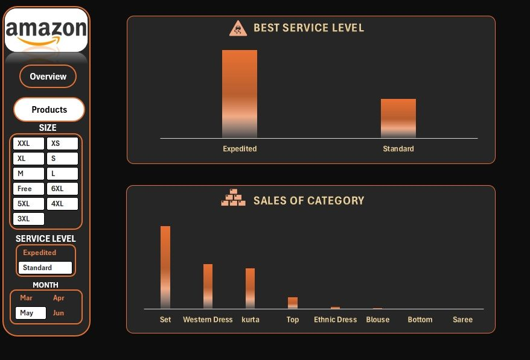
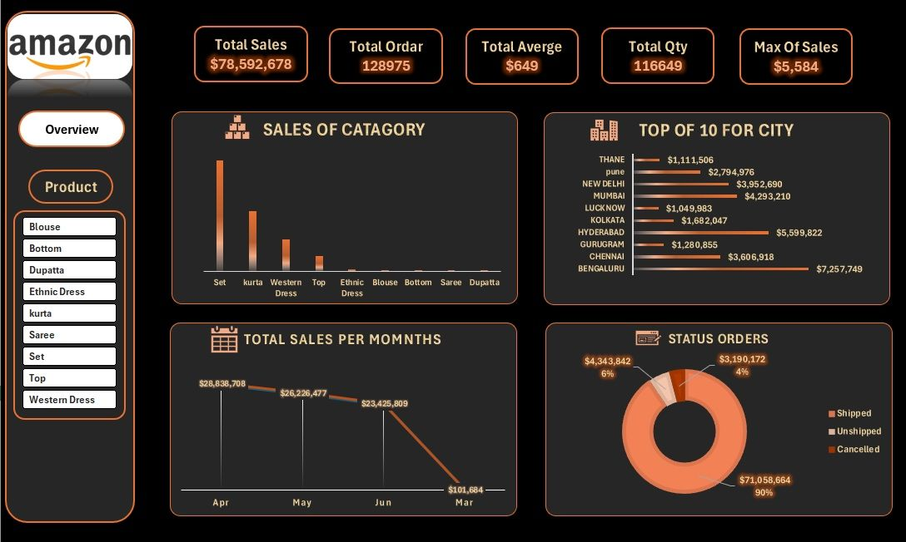

# 📊 Amazon Sales Performance & Regional Analytics Dashboard

## 📌 Project Overview
An interactive retail analytics dashboard evaluating **Amazon Sales Data** to translate raw transaction figures into clear executive business intelligence. The dashboard covers multi-period sales trends, top revenue-generating product categories, order volume progression, and regional distribution to support inventory and logistics decisions.

---

## 📈 Key Strategic Insights & Findings

* **📅 Sales Progression & Seasonality:**  
  Tracked sales volume and revenue velocity across quarters to identify demand spikes, shopping cycles, and seasonal revenue drivers.

* **🏷️ Category Performance & High-Margin Drivers:**  
  Segmented sales contributions across product departments, pinpointing top-selling categories and identifying underperforming product lines for inventory optimization.

* **🚚 Regional Market & Fulfillment Analysis:**  
  Analyzed customer geographic distribution and shipping fulfillment rates to evaluate regional delivery efficiency and logistics bottlenecks.

* **🎯 Executive KPI Indicators:**  
  Integrated custom visual cards tracking key retail health metrics: Total Sales, Total Order Quantities, Average Order Value (AOV), and Fulfillment Completion.

---

## 🛠️ Tech Stack & Methodology

* **Data Exploration & Transformation:** Structured raw e-commerce records, handled date formatting, and aggregated transaction metrics.
* **Metric Engineering & Calculations:** Computed period-over-period sales trends, category profit shares, and regional fulfillment benchmarks.
* **Interactive Dashboard Architecture:** Designed clear, high-contrast visual containers with interactive slicers for deep analytical exploration.

---

## 📷 Dashboard Gallery & Previews

### 1. Sales Trends, Order Volumes & Period Progression

### 2. Category Performance & Regional Market Breakdown

---

## 👨‍💻 Author & Connect
* **Elsayed Elkassas**
* **Portfolio:** [elsayed-elkassas.github.io/portfolio](https://elsayed-elkassas.github.io/portfolio/)
* **LinkedIn:** [linkedin.com/in/elsayed-elkassas-84686638a](https://www.linkedin.com/in/elsayed-elkassas-84686638a)
* **GitHub:** [github.com/elsayed-elkassas](https://github.com/elsayed-elkassas)
